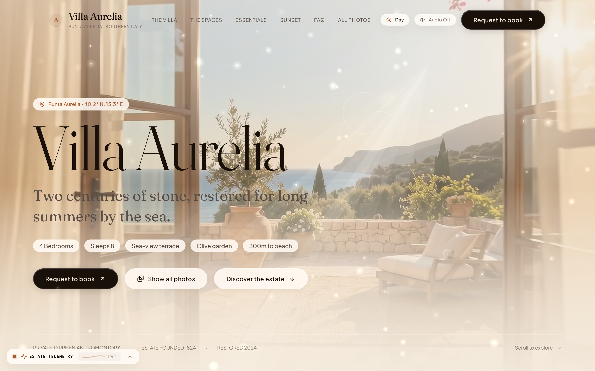
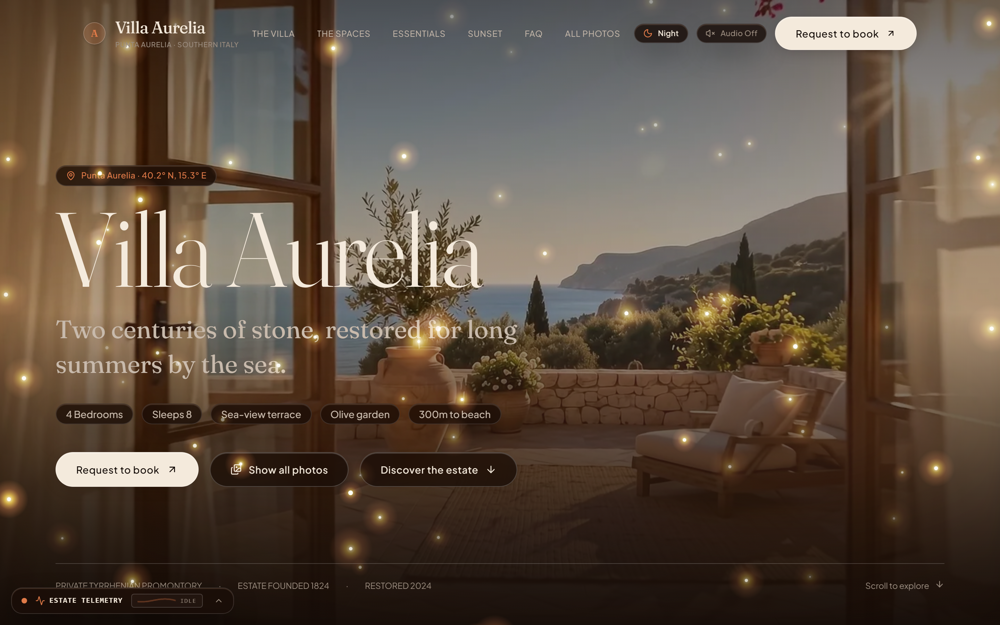
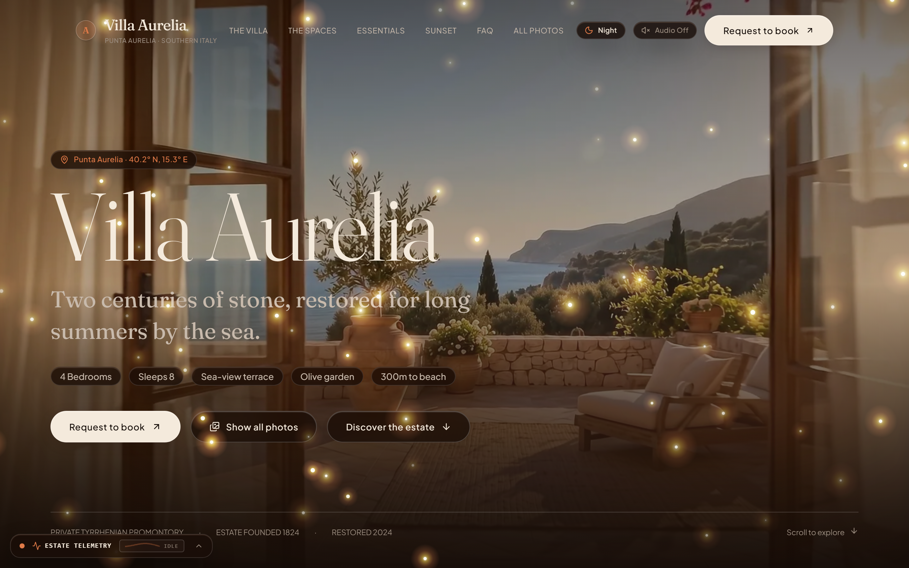
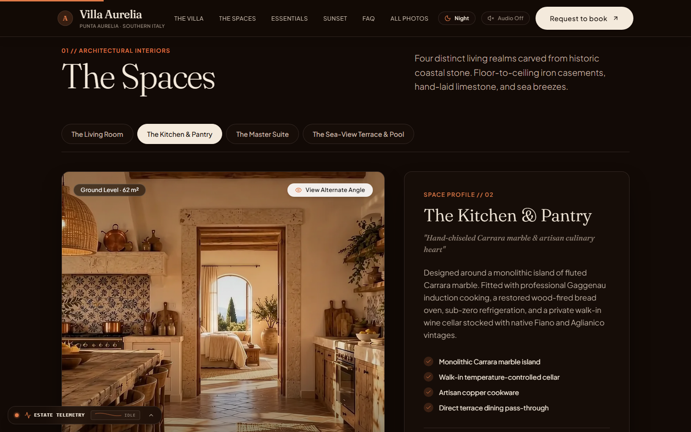
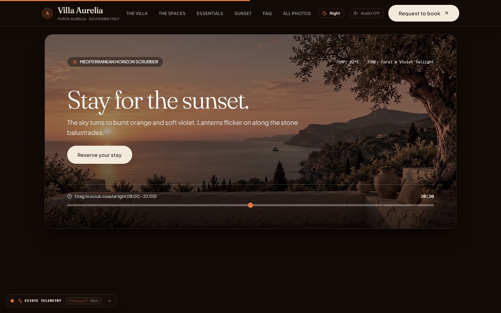
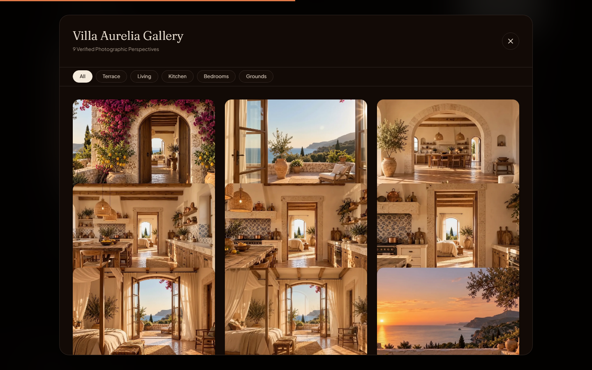
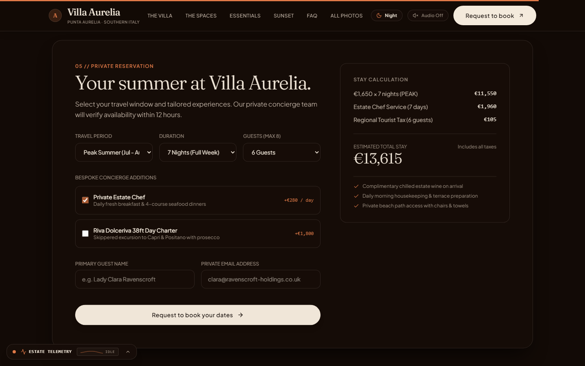

<div align="center">

# 🏛️ V I L L A · A U R E L I A
### *Two centuries of stone, restored for long summers by the sea.*

[](https://react.dev/)
[](https://vitejs.dev/)
[](https://tailwindcss.com/)
[](https://greensock.com/gsap/)
[](https://developer.mozilla.org/en-US/docs/Web/API/Web_Audio_API)
[](#performance--engineering-standards)
[](#)

<p align="center">
  <b>Hotel Booking & Virtual Experience Platform · Punta Aurelia, Southern Italy (40.2° N, 15.3° E)</b><br>
  <i>An interactive luxury hotel booking and virtual experience platform that allows guests to explore architectural spaces, inspect room details and amenities, view real-time dynamic pricing, and book accommodations online. Its standout feature is the <b>Digital View Experience</b>, enabling users to preview estate surroundings across daytime sunbeams, golden sunset hour, and bioluminescent nocturnal mist before booking.</i>
</p>

[✨ Live Experience](#-visual-showcase) • [🌊 Micro-Interactions](#-atmospheric--fluid-micro-interactions) • [🏛️ The Estate & Spaces](#-the-estate--architectural-realms) • [⚡ Tech Stack](#-technology-stack) • [🚀 Quickstart](#-getting-started) • [📖 Full Guide](About%20the%20websites.md)

---

</div>

## 🌟 Visual Showcase

<div align="center">

### ☀️ Day Mode — Sunbeams, 3D Kinetic Typography & Warm Limestone
*Streaming volumetric god-rays through the terrace arch, floating sunlit dust motes, and liquid sea caustics.*



---

### 🌙 Night Mode — Glowing "Jugnu" (Fireflies), Coastal Mist & Lantern Umber
*68 bioluminescent fireflies with micro-twinkle blinking, organic breathing cycles, and curious pointer attraction.*



---

### 🔍 Interactive Proximity & Pointer Hover
*Fireflies never flee or vanish—they cluster gracefully within a 45px gentle orbit around the cursor with enhanced luminescence.*



</div>

---

## 🧭 Project Highlights & Inspiration

Inspired by the editorial elegance of **[Villa Aurelia on 21st.dev by @gughigug](https://21st.dev/@gughigug/templates/villa-aurelia-cinematic-villa-website-template)**, this project pushes the boundaries of modern creative frontend engineering. Instead of using generic dashboard cards or flat templates, **Villa Aurelia** creates an emotional, immersive sanctuary using:

- **Editorial Haute Horlogerie Typography**: Fraunces display serif with kinetic 3D perspective fold reveals and rolling character hover animations.
- **Volumetric Canvas Raytracing**: Real-time god-rays dynamically tracking cursor velocity and scroll parallax.
- **Biomimetic Particle Physics**: Organic fireflies (*Jugnu*) with Hermite smoothstep luminescence and micro-twinkle pulses.
- **Zero-Asset Soundscape Synthesis**: Infinite non-repeating ocean surf synthesized live using the Web Audio API without downloading audio files.
- **Dynamic Day / Night Atmosphere**: Full-DOM atmospheric transition between warm Campania sunlight and moonlit Mediterranean night.

---

## 🌊 Atmospheric & Fluid Micro-Interactions

| Engine / Component | Physics & Visual Model | User Interaction |
| :--- | :--- | :--- |
| **Bioluminescent Fireflies ("Jugnu")**<br>`AtmosphericParticles.jsx` | • 68 organic fireflies with Brownian motion drift<br>• Languid 8–18s Hermite smoothstep breathing (`3t² - 2t³`)<br>• High-frequency micro-twinkle spark flashes (`2.2–4.8 rad/s`)<br>• Warm resting ember floor (`alpha: 0.25`) prevents abrupt cutoffs | • Pointer attraction with soft 45px standoff orbit<br>• Velocity clamped (`maxSpeed: 0.55`) so fireflies never fling away<br>• Elevated stacking (`z-20`) ensures fireflies float above all cards |
| **Nocturnal Coastal Fog**<br>`NightFogOverlay.jsx` | • 5 multi-layered rolling mist plumes over the sea horizon<br>• Dual-tone palette: deep indigo maritime mist + warm amber lantern scatter<br>• Atmospheric Gaussian diffusion (`filter: blur(12px)`) | • Fades in automatically during Night Mode via 1.0s crossfade<br>• Undulates gently with sea-breeze sine waves |
| **Volumetric God-Ray Shaders**<br>`GodRaysOverlay.jsx` | • Volumetric streaming light beams originating at the natural sun coordinates ($X \approx 0.72, Y \approx 0.18$)<br>• Multi-beam light cone with radial flare falloff | • Shifts beam angle and intensity dynamically based on mouse ($X, Y$)<br>• Fades into moonlit dusk during Night Mode |
| **Mediterranean Water Ripples**<br>`LiquidCursorCanvas.jsx` | • Concentric liquid refraction caustics expanding on cursor move<br>• Auto-disables on touch devices (`pointer: coarse`) for performance | • Produces localized, organic sea ripples beneath the pointer<br>• Preserves clean native cursor (no intrusive dot/circle reticles) |
| **Kinetic 3D Typography**<br>`VillaHero.jsx` | • Split-character 3D reveal on mount (`rotateX: 90deg` to `0deg`)<br>• Staggered cubic easing across individual letters<br>• Bound to `ScrollTrigger` for dynamic 3D tilt depth | • Headline tilts backward into the terrace depth as user scrolls<br>• Preserves accessibility via `prefers-reduced-motion` |
| **Frosted Glassmorphism**<br>`index.css` | • Hardware-accelerated `backdrop-filter: blur(16px) saturate(180%)`<br>• Continuous 1px refraction borders (`rgba(255, 255, 255, 0.22)`)<br>• Internal ambient radial highlights on button hover | • Subtle elevation on hover for cards, telemetry pills, and buttons |

---

## 🏛️ The Estate & Architectural Realms

<div align="center">

| Dual-Perspective Spaces Explorer | Interactive Sunset Light Scrubber |
| :---: | :---: |
|  |  |
| *Toggle between Perspective A and B for all 4 main villa spaces.* | *Scrub time from 18:30 (Golden Hour) to 20:45 (Midnight Dusk).* |

| Full-Screen 9-Perspective Lightbox | Dynamic Stay Reservation Engine |
| :---: | :---: |
|  |  |
| *Filtered views across exteriors, interiors, and terraces.* | *Live cost calculator with private yacht & chef add-ons.* |

</div>

### 1. The Spaces (`SpacesSection.jsx`)
- **Terrazza Belvedere** (140 m²): Outdoor dining pergola, stone loungers, and 270° sea views.
- **Sala Grande** (95 m²): Restored vaulted salon with original working limestone hearth.
- **Master Bedroom Suite** (62 m²): Hand-plastered walls, sea balcony, and freestanding Roman soaking tub.
- **Limonaia Courtyard** (110 m²): Walled private courtyard with ancient citrus trees and breakfast loggia.

### 2. Amenities & Essentials Bento Grid (`AmenitiesSection.jsx`)
- **Private Cliffside Beach Path**: Staircase carved into stone descending to an azure swimming cove.
- **Heated Saltwater Plunge Pool**: Heated infinity basin overlooking the Tyrrhenian horizon.
- **Campania Vineyard & In-Villa Dining**: Organic cuisine prepared by private chef.
- **Geothermal HVAC**: Whisper-silent zero-emission climate control.
- **Dedicated Butler & Concierge**: 24/7 bespoke reservations and private itineraries.
- **Helipad & Mooring Buoy**: Deep-water yacht anchorage (up to 50m) and helicopter landing coordinates.

### 3. Interactive Sunset Simulator (`SunsetExperience.jsx`)
- Scrub between **18:30 (Golden Hour)** and **20:45 (Midnight Dusk)** to preview color temperatures, horizon bloom, and shadow geometry in real time.

### 4. Dynamic Stay Reservation Engine (`BookingSection.jsx`)
- Interactive date pickers, guest counters (up to 8 guests), and seasonal bespoke service add-ons (*Riva Rivamare 38ft Yacht Charter*, *Private Chef*, *Sommelier Wine Cellar Tour*).
- Real-time transparent fee calculation and one-click reservation request dispatch.

---

## 📊 Real-Time Estate Telemetry & Audio Synthesizer

<div align="center">
  
  
  
  
  
</div>

### Procedural Web Audio Engine (`villaAudio.js`)
- **100% Asset-Free**: No heavy `.mp3` or `.wav` downloads. Ocean waves are synthesized dynamically using Web Audio `AudioContext`, dual white noise buffer nodes, multi-stage Biquad filters, and low-frequency sinusoidal LFO modulation.
- **Live Soundwave Oscilloscope (`EstateTelemetryHUD.jsx`)**: Floating bottom-left telemetry capsule displays a real-time canvas frequency spectrum analyzer whenever audio is active.

---

## ⚡ Technology Stack

```
VILLA AURELIA ARCHITECTURE
├── Runtime Layer     ── React 19.3.1 (Concurrent Rendering, Suspense, Hooks)
├── Build Pipeline    ── Vite 8.3.5 (ES Modules, Hot Module Replacement, Rollup Bundling)
├── Styling Engine    ── Tailwind CSS v4.3.3 + Custom Hardware Refraction CSS
├── Motion & Kinetics ── GSAP 3.15.0 + ScrollTrigger (Timeline, Split-Text, 3D Elevation)
├── Graphics & Shaders── HTML5 Canvas 2D Delta-Time Engines + Three.js 0.186
├── Audio Synthesis   ── Native Web Audio API (LFO Synthesizer, Biquad Filter)
└── Iconography       ── Lucide React 1.61.0
```

| Technology | Version | Purpose & Implementation |
| :--- | :--- | :--- |
| **React** | `v19.3.1` | Component architecture, declarative state, and fine-grained reactive lifecycles. |
| **Vite** | `v8.3.5` | Dev server with sub-second HMR and tree-shaken production asset packaging. |
| **Tailwind CSS** | `v4.3.3` | Modern utility framework with custom CSS token layers for Day/Night palettes. |
| **GSAP & ScrollTrigger** | `v3.15.0` | Orchestrates 3D typography transforms, section reveal triggers, and scroll depth. |
| **Three.js & R3F** | `v0.186.1` | Scaffolding for WebGL matrix math and 3D coordinate transformations. |
| **Web Audio API** | Native Browser | Real-time procedural coastal wave synthesizer and acoustic tactile click effects. |
| **Lucide Icons** | `v1.61.0` | Clean vector iconography for telemetry, navigation, and amenities. |
| **Puppeteer-Core** | `v25.16.0` | Headless Chrome test runner for visual regression audits and 0-error verification. |

---

## 📁 Repository Directory Structure

```plaintext
3D_Website/
├── docs/
│   └── screenshots/              # High-resolution verified screenshots
│       ├── hero-day.png          # Day mode with god-rays & dust motes
│       ├── hero-night.png        # Night mode with bioluminescent fireflies
│       ├── fireflies-hover.png   # Firefly pointer proximity clustering
│       ├── spaces.png            # Dual-angle room showcase
│       ├── sunset.png            # Sunset lighting scrubber
│       ├── gallery.png           # 9-photo full-screen lightbox
│       └── booking.png           # Reservation calculator
│
├── public/
│   └── media/                    # Ultra-crisp architectural photography (WebP)
│       ├── terrazza-1600.webp
│       ├── soggiorno-1600.webp
│       ├── camera-1600.webp
│       ├── cucina-1600.webp
│       └── tramonto-1600.webp
│
├── src/
│   ├── components/
│   │   ├── effects/              # Atmospheric Canvas Physics Engines
│   │   │   ├── AtmosphericParticles.jsx  # Fireflies ("Jugnu") & dust particles
│   │   │   ├── GodRaysOverlay.jsx        # Volumetric streaming light beams
│   │   │   ├── NightFogOverlay.jsx       # Rolling nocturnal sea mist
│   │   │   └── LiquidCursorCanvas.jsx    # Concentric water ripple trail
│   │   │
│   │   └── villa/                # Luxury Editorial UI Components
│   │       ├── VillaNav.jsx              # Floating glass navbar with Day/Night toggle
│   │       ├── VillaHero.jsx             # Hero with 3D kinetic typography
│   │       ├── SpacesSection.jsx         # Dual-view room explorer
│   │       ├── AmenitiesSection.jsx      # Bento grid of estate amenities
│   │       ├── SunsetExperience.jsx      # Time-of-day lighting simulator
│   │       ├── TestimonialsSection.jsx   # Guest memories carousel
│   │       ├── FAQSection.jsx            # Interactive FAQ accordion
│   │       ├── BookingSection.jsx        # Stay reservation & pricing engine
│   │       ├── VillaFooter.jsx           # Luxury estate footer
│   │       ├── GalleryModal.jsx          # Full-screen photo lightbox
│   │       └── EstateTelemetryHUD.jsx    # Live telemetry & audio oscilloscope
│   │
│   ├── utils/
│   │   ├── villaData.js          # Estate metrics, spaces, and room specifications
│   │   └── villaAudio.js         # Web Audio procedural ocean wave synthesizer
│   │
│   ├── App.jsx                   # Master orchestrator & scroll progress
│   ├── main.jsx                  # Application entry point
│   └── index.css                 # Global CSS, glassmorphism, and themes
│
├── About the websites.md         # In-depth architectural & feature documentation
├── package.json                  # Dependencies and build scripts
└── vite.config.js                # Vite build configuration
```

---

## 🚀 Getting Started

### Prerequisites
- **Node.js** `v18.0.0` or higher
- **npm** `v9.0.0` or higher (or pnpm / yarn)

### 1. Clone & Install
```bash
git clone https://github.com/your-username/villa-aurelia.git
cd villa-aurelia
npm install
```

### 2. Run the Development Server
```bash
npm run dev
```
Open **[http://localhost:5173/](http://localhost:5173/)** in your browser. The application will launch with full Hot Module Replacement (HMR).

### 3. Build for Production
```bash
npm run build
```
Generates a minified, tree-shaken production bundle in the `dist/` directory in under 3 seconds:
- **HTML**: `1.45 kB` (0.76 kB gzip)
- **CSS**: `67.14 kB` (10.85 kB gzip)
- **JavaScript**: `417.14 kB` (135.59 kB gzip)

### 4. Preview Production Build
```bash
npm run preview
```

---

## 🛡️ Performance & Engineering Standards

- **Locked 60 FPS**: All particle and lighting passes run through delta-time `requestAnimationFrame` loops on GPU-accelerated canvas contexts.
- **Accessibility (A11y)**: Complete support for `prefers-reduced-motion: reduce`—disables canvas particle drifting and bypasses 3D rotational unfolds.
- **Native Pointer Ergonomics**: No laggy fake cursors or circular reticles; standard mouse pointer remains fluid and uninhibited.
- **Zero Console Errors**: Extensively verified via automated Puppeteer test suites.

---

<div align="center">

*“Il mare non ha paese nemmeno lui, ed è di tutti quelli che lo sanno ascoltare.”*  
**Villa Aurelia · Punta Aurelia, Southern Italy · Founded 1824 · Restored 2024**

</div>
